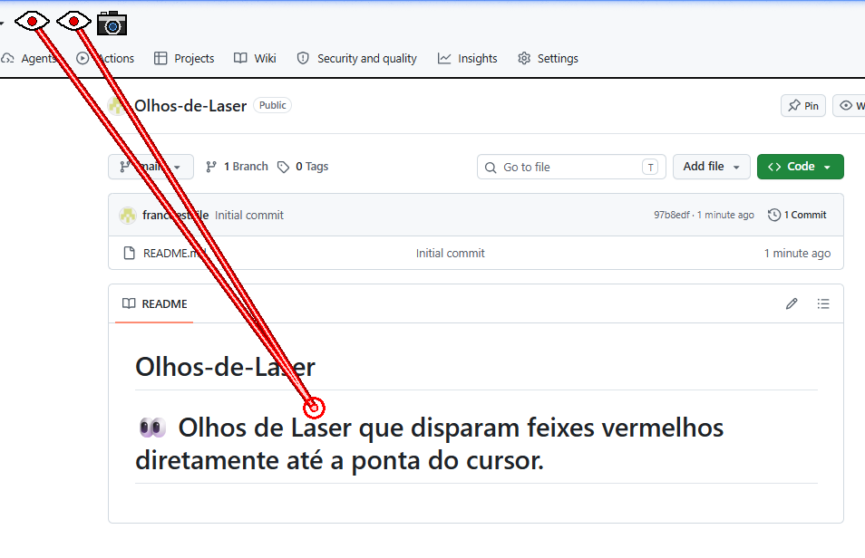

# Olhos-de-Laser
# 👀 Olhos de Laser que disparam feixes vermelhos diretamente até a ponta do cursor.


# 👀 Olhos de Laser (XEyes para Windows)

Um widget flutuante de área de trabalho para Windows inspirado no clássico *XEyes*, que acompanha o ponteiro do mouse por cima de qualquer janela (incluindo a barra de tarefas) e reage ao som, horário do dia, gravações de tela e atalhos rápidos.

---

## ✨ Funcionalidades

* **Sobreposição Absoluta:** Fica visível por cima de janelas maximizadas e da barra de tarefas do Windows.
* **Reação à Música:** As pupilas pulam e os olhos dilatam conforme as batidas graves do áudio tocando no PC.
* **Raio Laser do Ciclope:** Dispara feixes de laser vermelhos dos olhos diretamente até a ponta do cursor.
* **Lupa de Leitura Integrada:** Lente circular com zoom 2x que segue o mouse (invisível em capturas de tela).
* **Reações Contextuais Automáticas:**
  * ☕ **07h às 09h:** Aparece uma xícara de café fumegante ao lado dos olhos.
  * 😴 **22h às 06h:** Os olhos ficam semicerrados com expressão de sono.
  * 🎥 **Gravação de Tela:** Exibe uma filmadora com luz `REC` piscando ao detectar OBS, Ferramenta de Captura, Game Bar, ShareX, etc.
  * 📸 **Captura de Tela:** Faz pose e dispara flash ao pressionar `Print Screen` ou `Win + Shift + S`.

---

## ⌨️ Controles e Atalhos

| Ação / Tecla | O que faz |
| :--- | :--- |
| **Arrastar com Botão Esquerdo** | Move os olhos para qualquer lugar da tela (salva a posição automaticamente) |
| **Botão Direito nos Olhos** | Abre o menu para trocar o visual manualmente, ativar a lupa ou fechar |
| **Segurar `F8`** | Dispara o raio laser até o cursor do mouse |
| **Apertar `F9`** | Liga ou desliga a Lupa de Leitura |
| **`ESC`** | Desliga a Lupa de Leitura |

---

## 🚀 Como Usar

### Opção 1: Baixar o Executável Pronto (Recomendado)
1. Vá até a aba **[Releases](../../releases)** aqui no GitHub.
2. Baixe o arquivo **`OlhosDeLaser.exe`**.
3. Dê dois cliques para executar (não precisa instalar nada).

### Opção 2: Rodar pelo Código-Fonte (Python)
1. Instale as dependências:
   ```bash
   pip install numpy soundcard
